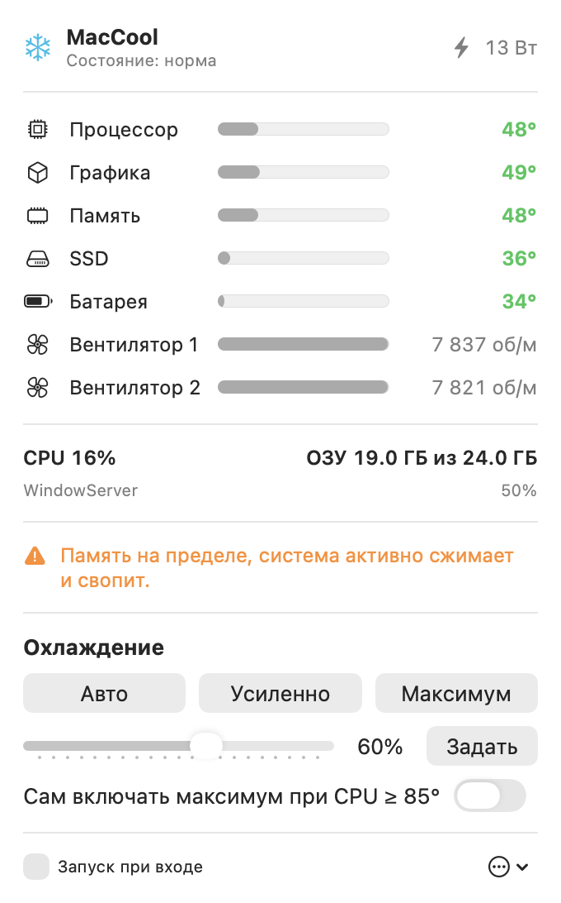

<p align="center"></p>

# MacCool

Программа для строки меню macOS: показывает, насколько нагрет мак и чем он занят, и позволяет включить охлаждение, когда захочешь.

*A tiny macOS menu bar app that shows temperatures, fan speeds and CPU/RAM load, and lets you crank the fans up on demand (Apple Silicon MacBook Pro).*

<p align="center"></p>

## Что умеет
- Температуры процессора, графики, памяти, SSD и батареи (из SMC — датчиков чипа).
- Обороты вентиляторов и потребление системы в ваттах.
- Загрузка CPU, занятая память и 5 самых прожорливых процессов.
- Подсказки: перегрев, троттлинг, нехватка памяти, горячая батарея, какое приложение грузит процессор.
- Управление вентиляторами:
  - **Авто** — как обычно, управляет macOS;
  - **Усиленно** — 50% между минимумом и максимумом;
  - **Максимум** — полные обороты;
  - ползунок — любая скорость от 0 до 100%;
  - **авто-буст** — сам включает максимум, когда CPU доходит до порога, и возвращает «Авто», когда остынет на 15°.

Защита: если вручную задана низкая скорость, а процессор нагрелся до 95°, включается максимум. При выходе из программы вентиляторы всегда возвращаются системе. После сна выбранный режим применяется заново.

## Требования
- Mac на Apple Silicon с вентиляторами (MacBook Pro, Mac mini, Mac Studio). На MacBook Air вентилятора нет — будет работать только мониторинг.
- macOS 14 или новее.
- Разработано и проверено на MacBook Pro M5 Pro. На других чипах ключи датчиков могут отличаться.

## Установка

### Из исходников (рекомендуется)
Нужны только Command Line Tools (`xcode-select --install`), Xcode не обязателен.
```bash
git clone https://github.com/VANHAUNDER/MacCool.git
cd MacCool
./build.sh install
```
Приложение соберётся, переместится в «Программы» и запустится.

### Готовая сборка
Скачай `MacCool.zip` из [Releases](https://github.com/VANHAUNDER/MacCool/releases), распакуй и перенеси в «Программы».
Приложение не подписано сертификатом Apple, поэтому macOS его заблокирует. Сними карантин:
```bash
xattr -dr com.apple.quarantine /Applications/MacCool.app
```

## Помощник для вентиляторов
Менять обороты может только root, поэтому при первом нажатии «Установить помощника» macOS один раз спросит пароль администратора.
Ставится маленькая утилита `/Library/PrivilegedHelperTools/maccoolctl` (владелец root, бит setuid). Она умеет только три команды:
```
maccoolctl auto          # вернуть управление системе
maccoolctl max           # максимум
maccoolctl set <0-100>   # процент между минимумом и максимумом
```
Её исходник — [`Sources/maccoolctl.c`](Sources/maccoolctl.c). Удалить: меню «…» в панели → «Удалить помощника».

> Любая программа на этом маке сможет вызвать помощника и поменять обороты. Ничего другого он не умеет, но имей это в виду.

## Устройство
| Файл | Что делает |
|---|---|
| `Sources/smc.c` | чтение и запись ключей SMC через IOKit |
| `Sources/maccoolctl.c` | root-помощник для управления вентиляторами |
| `Sources/Sensors.swift` | температуры, вентиляторы, CPU, память, процессы |
| `Sources/Monitor.swift` | опрос раз в 2 секунды, подсказки, авто-буст |
| `Sources/FanController.swift` | установка и вызов помощника |
| `Sources/MacCoolApp.swift` | интерфейс (SwiftUI) |
| `tools/make_icon.swift` | генерирует иконку |

## Лицензия
MIT. Используй на свой страх и риск: программа меняет режим работы вентиляторов.
